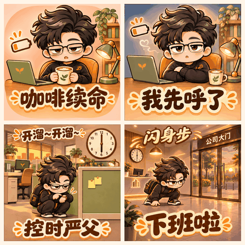
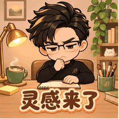

# BSS · 微信动态表情工作室

**只需一张照片，即可获得一套有文字、有场景、有小剧情的动态表情包与微信投稿素材。**

`bss-story-sticker-studio` · `v0.1.0-beta.1` · 公开测试版

上传一张人物照片、动物照片或原创角色图，让支持图像生成与 Python 执行的智能体完成角色设计、文案策划、故事分镜、GIF 合成和检查。默认采用精绘 Q 版，也可以按自己的喜好调整画风、背景、字体和动作。拿到成品后，可以继续精修，再自行投稿。

> 这是供智能体使用的 Skill，需要所在环境具备图像生成能力。仓库不包含生图模型，单独运行脚本不会自动生成图片。

## 作品动图与示例

### 职场精绘：从情绪到小剧情



四张独立GIF组成的动态展示，涵盖半身回应、桌边入睡、办公隔断潜行和公司门口闪身。合集用于首页观看，单张保留240×240聊天尺寸。

| 示例 | 场景与动作设计 |
| --- | --- |
| [咖啡续命](previews/coffee.gif) | 温暖办公桌前，借咖啡表达困倦与提神 |
| [我先呼了](previews/sleep.gif) | 趴在桌面逐渐入睡，用鼻尖小气泡表达睡意 |
| [控时严父](previews/sneak.gif) | 6点办公室，背包蹲下，沿隔断潜行 |
| [下班啦](previews/off-work.gif) | 公司大门口，以“闪身步”快速离场 |

这些是本项目经过多轮人工反馈与精修的作品，用于展示我们希望达到的方向；不代表任意输入一次自动生成即可达到相同效果。作品已提交微信审核，当前尚无审核通过或上线证明。

### 单张流程测试：灵感来了



从原创卡通参考新生成母版与六帧分镜，运行导出、实际解码检查和打包。展示思考、灵感亮起、拿笔创作的过程；仍能看到关键帧切换与循环重启的变化，不将它等同于连续视频。

动物照片也可用同一通用启动方式制作。另一台电脑的龙猫测试已有用户反馈和截图，实际GIF尚未收集，因此本页暂不以截图冒充动物动图演示。

以上角色与演示图像用于展示项目效果，不作为每位用户的默认素材；其权利不随代码的MIT许可证一并授予。制作时请上传自己的照片或有权使用的角色。

## 我们想做什么

从“一个角色换不同文字”，走向“角色在场景里完成一个小故事”。

例如，“收到啦”可以是小屋门口取信后点头，“咖啡续命”可以是从困倦到喝咖啡恢复精神，“下班啦”可以是背包穿过公司大门。背景、表情、文案和动作共同表达聊天情绪，而不是只在透明底上摆放角色与小道具。

- **角色一致**：先制作角色母版，再引用母版生成连续动作。
- **文字入画**：文案实际显示在 GIF 内，核对字形、位置和小尺寸可读性。
- **故事场景**：根据用途自动设计环境与小剧情，用户无需另找背景图。
- **可定制、可精修**：保留已接受部分，修改指定表情、帧、文字或背景。
- **可检查的交付**：提供独立 GIF、实际解码帧总览、动态预览和技术报告。
- **投稿准备**：制作封面、图标、横幅等配套素材；实际注册、上传与审核由用户另行完成。

## 快速开始

### 1. 安装 Skill

下载本仓库 ZIP 并解压，将包含 `SKILL.md` 的整个文件夹放入技能目录，文件夹名称设为 `bss-story-sticker-studio`。

默认技能目录示例：

| 系统 | 文件夹位置 |
| --- | --- |
| Windows | `%USERPROFILE%\.codex\skills\bss-story-sticker-studio\` |
| macOS / Linux | `~/.codex/skills/bss-story-sticker-studio/` |

如果已自定义技能目录，请使用自己的配置。解压下载包时注意避免多套一层目录，正确结构应为：

```text
skills/
└── bss-story-sticker-studio/
    ├── SKILL.md
    ├── README.md
    ├── requirements.txt
    ├── scripts/
    └── references/
```

安装或更新后，新开对话。如已经安装之前的旧品牌版本或 `story-sticker-studio`，请用新版替换旧技能，避免同时保留两套造成调用混淆。现在的调用名是 `$bss-story-sticker-studio`。

### 2. 上传参考图片

可以上传清晰的人物照片、动物照片，或已有的原创角色图。尽量让主要特征可辨认，遮挡少一些；不必自己先转换为 Q 版。

### 3. 发送通用启动词

直接复制：

> 使用 $bss-story-sticker-studio，根据我上传的图片制作一套动态表情包。未指定的内容按默认标准自动策划，完成角色设计、文案、场景、小剧情、GIF制作和检查，交付成品、动态预览及微信投稿配套素材，不要直接发布。

无需自己逐张编写生图提示词。助手负责把普通制作要求转换为具体计划与生成提示词。

## 默认会制作什么

| 项目 | 默认方式 |
| --- | --- |
| 角色 | 精绘 Q 版，保留参考图的辨识特征；动物保持动物身份 |
| 数量与语言 | 12 张，中文 |
| 主题 | 人物为职场日常；动物为日常聊天 |
| 背景 | 与文案和动作相应的精绘故事环境 |
| 文字 | 每张 GIF 内有对应文案，带适合画面的字形、描边与配色 |
| 动作 | 情境触发 → 角色反应 → 动作结果，按需要设计文字动效 |
| 技术起点 | 240×240 GIF、循环播放，默认 6 个关键帧，按动作调整 |
| 推进方式 | 先做一张完整样张自检，再扩展整套，无需每阶段等待用户确认 |

这些都是可覆盖的默认值。需要先看母版或样张，可以直接说“先给我一张确认，再继续”。6 个关键帧不等于流畅视频，动作及首尾衔接仍需检查。

## 做成自己的风格

不必使用固定的长提示词，在通用启动词后补充想法即可。

| 想调整什么 | 可以这样说 |
| --- | --- |
| Q 版比例 | 头更大一点，轮廓简化，表情夸张一些，减少写实毛发细节 |
| 保留特征 | 保留眼镜和发型；保留这只猫的毛色花纹与耳形 |
| 画风 | 温暖水彩感；简洁平涂漫画；保留原角色图画风 |
| 配色 | 奶油色系；暖橙配鼠尾草绿；清爽蓝白 |
| 场景 | 整套森林小屋；温馨咖啡馆；蓝白办公室 |
| 简洁版本 | 改成透明背景加必要道具，不需要完整环境 |
| 字体与文字 | 圆润手写字，深色填充加浅色描边，包含“收到”“谢谢” |
| 动作 | 咖啡入口后眼睛亮起来；收到周末通知后欢呼 |
| 数量与主题 | 做8张吃货日常；做12张节日祝福 |

字形可以描述视觉特征，也可以提供有权使用的字体或参考图；生成字形不等于某款商业字体。不同风格方向的实际效果取决于当前工具，并非全部已经过验证。

希望更详细地描述，可以使用这个模板，删掉不需要的项目：

> 使用 $bss-story-sticker-studio，以这张图片为角色参考，制作[数量]张[主题]动态表情。保留[角色辨识特征]，采用[画风与比例]、[配色]，搭配[背景场景]。文字采用[字形与颜色]，包含[指定文案，或由你策划]。每张设计专属表情和连贯小剧情。请[自动完成整套，或先给角色母版]，交付GIF、动态预览、检查报告及[所需配套素材]，不要直接发布。

## 拿到成品后怎么精修

用普通话说明修改范围，越具体越容易保留已经满意的部分：

> 第2张文字放大一点，保留角色、场景和动作。

> 第3张最后两帧的耳朵变形了，只修这两帧，参照前面正确的耳形。

> 这套太写实了，整体改成更大头、更简化的Q版，文案和小剧情不变。先给一张看效果。

> “收到啦”需要完整的小屋门廊场景，不要只有透明底加信箱；保持龙猫形象和文案。

精修后应重建 GIF，查看实际解码帧；不要只看原始分镜或旧版预览。

## 制作流程与交付

**参考图 → 角色母版 → 文案与故事策划 → 连续分镜 → GIF合成 → 技术与视觉检查 → 打包交付**

默认交付目标包括：独立 GIF、解码帧总览、可播放 HTML、技术报告、投稿配套素材及填写文案。角色母版和工作源文件留在项目中，默认不放入成品分享包。

内置脚本可检查 GIF 尺寸、体积、循环、帧时长、实际解码变化及源文件一致性，并支持封面、图标、横幅的基础规格检查。文字正确、角色结构、环境连续性与动作自然度需要视觉检查，不能用技术 PASS 替代。

赞赏图、艺术家资料等按实际需要另行制作。当前脚本的附件检查与打包支持封面、图标、横幅，不覆盖所有账户材料；若另做赞赏素材，需要单独核对并交付。资料或素材缺失时应列待办，不能把不完整文件称为完整投稿包。

## 运行要求

- 能读取参考图、生成图像并执行本地文件操作的智能体环境。
- Python 3.10+、Pillow，依赖范围见 [requirements.txt](requirements.txt)。
- 如后期排字，需要当前电脑可用且覆盖所需文字的授权字体。

优先使用环境内置的图像工具，不要求绑定固定 API。仓库不包含模型或 API 额度，生成费用和可用能力取决于所在环境。没有图像工具时，只能交付计划与提示词，不能声称已经完成图片或动图。

## 微信投稿说明

素材规范记录在 [微信投稿配置](references/wechat-profile.md)，来自注明日期的官方规范快照。提交前请在 [微信表情开放平台](https://sticker.weixin.qq.com/cgi-bin/mmemoticon-bin/readtemplate?t=home/index) 核实最新要求。

有背景、有文字的表情主体，与透明无字的封面、图标是不同用途，应分别制作。尺寸、格式符合要求不等于通过内容审核。项目不保证过审或收入，不自动注册、实名、接受协议、绑定收款或发布作品。

## 常见问题

**只有一张普通照片可以吗？**  
可以作为输入。默认先转成精绘 Q 版母版；如果希望保留写实或原角色风格，请明确说明。

**背景需要自己准备吗？**  
不需要，默认根据每张文案和小剧情自动设计。也可以指定场景，或提供有权使用的参考图。

**生成后只有文件名有字，画面没字？**  
这不符合默认有字标准。要求保留角色动作、补对应文字层，再重新导出并检查实际 GIF。

**能否直接把 ZIP 上传微信？**  
交付 ZIP 是便于下载的成品集合，不代表微信后台接受 ZIP 一键投稿。按后台各项要求分别上传素材、填写资料并提交。

**为什么仍需要精修？**  
字形、耳朵、头发、道具位置和循环可能出现漂移。Skill 提供检查及修复流程，但不能保证任意照片、任意动作一次成功。

## 测试状态

当前版本为早期公开测试版：

- 本地原创卡通角色单张新生成、GIF导出、实际解码检查与打包链路已跑通；5项脚本测试通过。
- 用户在另一台电脑测试动物照片，反馈已生成12张带文字与故事场景的作品，并提供预览截图。尚未取得该交付包逐帧复核，因此不能把截图当成整套视觉质量通过。
- 新真人照片、更多动物种类、不同风格和复杂动作的批量稳定性仍需测试。

反馈问题时，请说明环境、输入类型、启动要求、预期与实际结果，并附有问题的帧号或已去除隐私的截图。请勿把私人照片、密钥或实名材料上传到公开 Issue。

## 开发者：本地脚本

普通用户可让助手执行这些步骤，无需手动逐条运行。若手动操作，在仓库目录中安装依赖：

```sh
python -m pip install -r requirements.txt
python scripts/studio.py init ./my-pack --photo /path/to/photo.png
# 编辑 plan.json，填写实际主题、场景与动作
python scripts/studio.py prompts ./my-pack
# 由宿主图像工具生成母版、分镜，保存到 plan.json 指定的 sources 路径
python scripts/studio.py build ./my-pack
python scripts/studio.py check ./my-pack
python scripts/studio.py pack ./my-pack
```

`init` 的计划种子是职场示例；动物或自定义主题由助手按输入调整。`prompts` 导出制作提示词，不调用生图服务。`build` 合成，`check` 检查，`pack` 重检后打包；只有提示词而没有源图时无法生成 GIF。

测试命令：

```sh
python -m unittest discover -s tests -v
```

更多实现说明：[角色与场景](references/direction.md) · [提示词与精修](references/prompts-and-repair.md) · [计划格式](references/plan.md) · [Skill入口](SKILL.md)

## 原创、隐私与许可证

本版本根据实际制作中遇到的文字漂移、重复耳朵、发型变形、便条变化和图层问题独立编写。研究过公开表情制作流程的思路，未复制其代码、水印、角色素材或作者配置。

公开包不包含私人参考照片、个人署名或开发者机器路径。成品分享包默认排除原始照片和源分镜；本地项目仍包含这些工作素材，不应直接整目录公开。

代码与文档采用 [MIT License](LICENSE)。输入照片、用户作品、第三方字体和生成图像的权利不因代码许可证一并授予。请使用自己或有权使用的素材。

这是 BSS 的独立项目，并非微信或腾讯官方产品。
